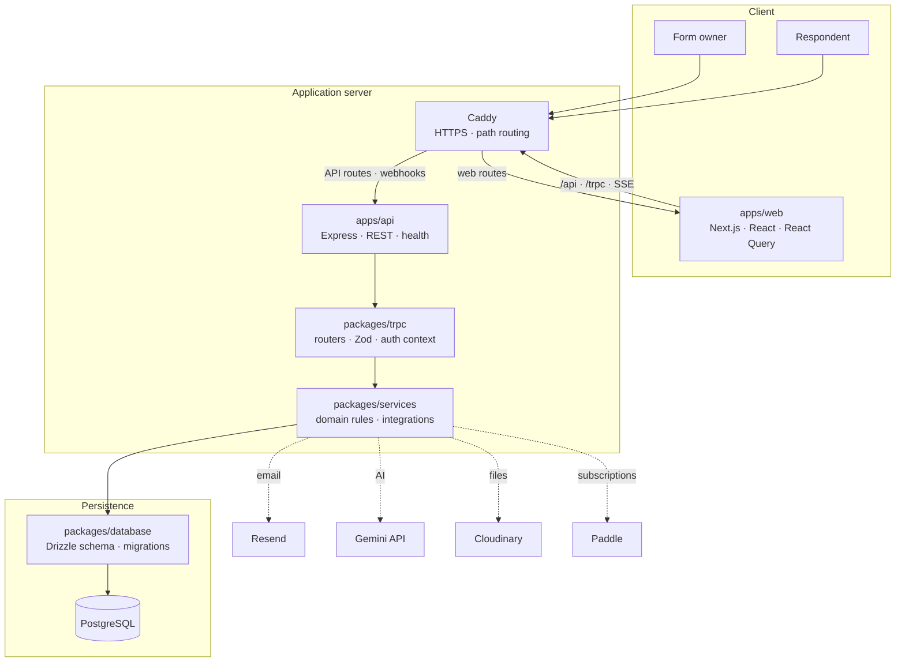
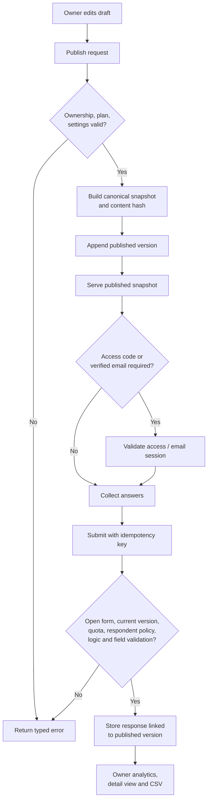

# Dockett — Project Case Study

## Executive summary

Dockett is a production-oriented form creation and response platform. It combines a visual form builder, public respondent flows, account and respondent verification, analytics, exports, AI-assisted authoring, optional file uploads, and subscription-based entitlements. Its architecture is a TypeScript monorepo: a Next.js web application and an Express API share typed tRPC contracts and domain services, with PostgreSQL as the system of record.

The central architectural decision is to keep editable form content separate from the published contract respondents use. Publishing creates an immutable, content-hashed snapshot; submissions are validated against that snapshot and retain its version reference. This lets owners continue editing while published responses stay interpretable against the questions respondents actually saw.

## Product and user journeys

### Form owner

1. Create a form from a blank canvas, a template, or an AI-generated draft.
2. Arrange and configure fields in the builder, preview the respondent experience, and select a visual template and submission layout.
3. Publish as an open link or require an access code; optionally require verified respondent email, limit one response per address, or schedule a close.
4. Share a public URL or QR code.
5. Review response and view metrics, inspect individual submissions, download CSV data, and manage the account or subscription.

### Respondent

1. Open a shared form link.
2. If configured, enter an access code and/or verify an email address through a time-limited link; a Dockett account is not required.
3. Complete the form in one-question-at-a-time or all-at-once mode. Conditional rules determine which questions apply.
4. Submit answers (and any confirmed file uploads). The server checks availability, the published version, response limits, respondent rules, and field values before storing the response.

## Technology stack

| Concern            | Implementation                                                                                          |
| ------------------ | ------------------------------------------------------------------------------------------------------- |
| Language           | TypeScript throughout the application and shared packages                                               |
| Workspace          | pnpm 9 workspaces and Turborepo 2 task graph                                                            |
| Frontend           | Next.js 16 App Router, React 19                                                                         |
| UI and interaction | Tailwind CSS 4, Radix UI primitives, React Query, tRPC React, React Hook Form, XYFlow, Recharts, Lucide |
| API                | Node.js, Express 5, tRPC 11, Zod validation                                                             |
| API compatibility  | OpenAPI generated from tRPC metadata; Scalar API reference                                              |
| Database           | PostgreSQL 15, Drizzle ORM and Drizzle Kit                                                              |
| Authentication     | Signed JWT access/refresh tokens in cookies; Google sign-in; Resend email flows                         |
| AI                 | Gemini API, streamed to the browser with Server-Sent Events                                             |
| Billing            | Paddle checkout, portal, and signed webhooks                                                            |
| Upload storage     | Optional Cloudinary direct-to-storage upload flow                                                       |
| Deployment         | Docker multi-stage image, Docker Compose, Caddy, AWS EC2, GitHub Actions                                |

The package versions are owned by the package manifests and lockfile. Production currently builds with Node.js 24 and pnpm 9; the root manifest declares Node.js 18 as the minimum engine.

## Architecture

### Repository boundaries

- **`apps/web`** owns user experience and client-side composition: landing and legal pages, authentication screens, dashboard, form creation, public form rendering, analytics, billing, and settings.
- **`apps/api`** is a distinct HTTP process. It mounts tRPC and generated REST endpoints, handles AI streaming and Paddle webhooks as explicit Express routes, serves health and API documentation endpoints, and starts form/upload lifecycle jobs.
- **`packages/trpc`** contains the central router, procedures, context, endpoint models, route-to-service coordination, and OpenAPI metadata. The web app imports this router type to provide end-to-end typed requests.
- **`packages/services`** owns business rules rather than UI concerns: forms, publication/versioning, fields, response validation, analytics, user identity, respondent email verification, AI, billing, and upload lifecycle.
- **`packages/database`** centralizes Drizzle's PostgreSQL connection, schema, typed table models, and migration history.
- Shared logger, ESLint, and TypeScript configuration live in `packages/logger`, `packages/eslint-config`, and `packages/typescript-config`.

The main runtime dependency direction is web → API contract → domain services → database. External vendors are accessed through service-level modules rather than from React components.

## Feature and domain design

### Form authoring and rendering

The builder supports 12 active field types: short text, long text, email, number, single-select, multi-select, date, radio group, checkbox group, rating, yes/no, and file upload. Field-specific settings live in JSON configuration; the database stores field order, required state, label, and type independently.

Forms choose from nine shells—Classic, Corporate, Survey, Education, Developer, Retro, Invitation, Ticket, and Landing—with customizable accent, surface mode, typography, and corner style. The respondent can see all questions at once or progress through one question at a time. Both modes use a shared field renderer and submission-flow owner, while template shells control presentation; this prevents each theme from implementing its own validation and step behavior.

The builder exposes both a list view and a node/canvas view. Template creation, live preview, QR generation, and share/publish dialogs support the full path from draft to distribution.

### Conditional logic

Question configuration can define comparisons and multiple AND/OR conditions targeting other fields. Shared form-logic code calculates the active respondent path. The server independently checks the logic graph and rejects values for fields outside the active path, so hiding a question in the browser is not the security or correctness boundary.

### Publication, versions, and response consistency

Publishing freezes the respondent-visible title, description, template, layout, design settings, and ordered fields as a version snapshot. The service hashes canonical content with SHA-256 and uses the content hash to identify meaningful changes; timestamps are excluded from the identity. Version rows are append-only and unique by `(formId, version)`.

Each submission stores a `versionId`. Answer validation uses that version's snapshot rather than the mutable builder draft. This preserves question wording, options, required flags, and field types as they existed when the respondent answered. A compatibility helper creates the initial snapshot for older published forms that predate versioning.

Forms transition among `DRAFT`, `PUBLISHED`, and `CLOSED`. A scheduled deadline (bounded to 5 minutes through 30 days) or 30 days of inactivity can close a form. The API calculates effective closure when a form is read or submitted; a periodic sweep also updates persisted state. Thus a delayed sweep does not leave a form accepting responses after it should be closed.

### Respondent identity and answer integrity

Respondents may be anonymous or prove email ownership through a short-lived magic link, without creating an account. Owners can configure a shared access code and, for verified-email forms, enforce one response per address. The database unique index on the normalized `emailKey` makes the one-response rule race-resistant. A submission idempotency key ensures a retried fill attempt returns the original submission instead of duplicating it.

Server-side validation checks field existence and uniqueness in the request, answer length, required answers, type-specific constraints (including date, email, number, rating and options), conditional path, and upload references. Public form procedures can resolve an optional signed-in owner without requiring every visitor to authenticate.

### Analytics and exports

Owners can review total responses, recorded views, completion rate, a 14-day response timeline, and a coarse device classification inferred from the user-agent. They can inspect submissions and export CSV with one column per field, including answers and publication version metadata. Ownership checks are performed in the service/API path before returning analytics or submissions.

View tracking is explicitly best-effort: a tracking write failure must not block form display. Device breakdown is intentionally lightweight user-agent classification, not a full analytics or identity product.

### AI form assistant

The AI builder generates and refines structured form drafts and can either create a new form after owner approval or apply a draft to an open builder. Its backend endpoint is `POST /ai/form/stream`, delivered as SSE because the interaction needs incremental events and browser cancellation.

The handler layers low-cost checks before model work: IP throttling, same-site origin validation, content type, access-token verification, then AI-engine limits. The engine includes schema/prompt guards, per-plan quotas, per-IP and global budgets, output limits, retry/fallback behavior, circuit-breaker resilience, idempotency/single-flight handling, and persisted usage accounting. Configuration currently targets Gemini Flash/Flash-Lite families only; the feature depends on a valid Gemini API key and available upstream free-tier quota. A missing AI configuration disables this feature rather than being presented as a paid multi-provider system.

### File uploads

The browser does not proxy file bytes through the API. Instead, it requests a signed upload, sends bytes directly to configured storage, and asks the API to confirm the stored object. The server verifies file kind, size, and magic bytes before accepting it for a response. Upload rows track pending, confirmed, and attached states; a scheduled cleanup removes abandoned or orphaned objects. The implementation uses Cloudinary when configured; without its credentials, the upload field can exist but the upload operation is unavailable.

### Authentication, billing, and plans

Owner accounts support password sign-up/sign-in, Google sign-in, email verification, password reset, refresh, and logout. Short-lived access and longer-lived refresh tokens are cookie-based; password credentials are stored as hashes. Email and token flows use server-side services.

Basic, Pro, and Business plans share one plan definition as the source for display and enforcement. The current definitions specify:

| Plan     | Active forms | Responses per form/month | Other plan behavior                                                                   |
| -------- | -----------: | -----------------------: | ------------------------------------------------------------------------------------- |
| Basic    |            5 |                      100 | Standard templates and limited AI usage                                               |
| Pro      |           50 |                    1,000 | Premium templates and higher AI allowance; monthly or yearly checkout when configured |
| Business |    Unlimited |                Unlimited | Contact-sales offering                                                                |

Entitlement checks are performed by backend services at operations that consume a limit; the frontend plan UI is not the enforcement layer. Paddle events are authenticated from the exact raw request body, signature-checked, and applied idempotently by event ID. The subscription record is the source of truth for plan access, and older/out-of-order webhook events are ignored. Paddle is optional until configured.

## Key engineering decisions

1. **Share the API contract, not implementation details.** tRPC input/output types and React Query keep web calls statically aligned with server routers; Zod runtime schemas and OpenAPI/REST routes preserve runtime validation and interoperability.
2. **Make domain services the policy boundary.** Limits, validation, publication rules, account checks, and integrations live outside page components and endpoint handlers, so distinct clients follow the same rules.
3. **Version what respondents saw.** Immutable snapshots plus submission-to-version references avoid historical responses being reinterpreted after owners edit a form. Content hashing makes unchanged republishing distinguishable from changed publication.
4. **Recheck important rules on the server.** Field validation, conditional path, form ownership, access gating, publication status, quotas, and one-response constraints do not depend on the browser. Database constraints close race windows where application checks alone would be insufficient.
5. **Treat optional vendors as feature dependencies.** AI, Cloudinary, and Paddle configuration is loaded at feature boundaries where possible; optional integrations should disable their feature rather than the core API. Resend and account-level identity configuration are required for the currently configured API runtime.
6. **Keep uploads off the application data path.** Signed direct-to-storage uploads avoid routing large file bodies through Express; confirmation, state tracking, ownership quotas, and cleanup preserve application-level control.
7. **Give asynchronous integrations explicit failure semantics.** AI uses SSE and cancellation; Paddle receives raw bytes for signature verification and returns retriable server failures; form view recording is best-effort; deployments use health checks and can roll back the application image.
8. **Separate local and production persistence.** The local Compose database has its own volume and loopback port binding. Production references an existing named PostgreSQL volume and the deployment script refuses to proceed if that expected volume is absent.

## API and request flows

### Web/API request path

The web app uses typed tRPC over `/trpc` for application data. The API also exposes generated OpenAPI-compatible REST endpoints under `/api`, with the generated document at `/openapi.json` and Scalar documentation at `/docs`. AI SSE and Paddle webhooks are explicit Express routes because they need streaming and raw-body semantics respectively.

### Publish and submit

### HTTP routing in production

Caddy terminates HTTPS and routes API paths (including `/api`, `/trpc`, AI streaming, webhooks, docs, and health) to the API process on port 8000. Other requests go to Next.js on port 3000. The API and web application run together in the application container; PostgreSQL is a separate Compose service on an internal network.

## Operations, environments, and deployment

### Local development

The root scripts use `dotenv-cli` and Turbo. Copy `.env.example` to `.env`, set the local PostgreSQL URL and API-required values, start the dedicated development database, apply migrations, and run `pnpm dev`. The development database maps only to `127.0.0.1:5432` and uses a separate named volume.

Database schema changes are managed through Drizzle Kit: update the schema under `packages/database`, run `pnpm db:generate`, then apply with `pnpm db:migrate`. Keep generated migration files and schema updates in sync.

### Production

The GitHub Actions workflow runs for pushes to `main`. Its first job installs the locked pnpm workspace and runs lint and type checks. After CI succeeds, the pipeline builds a single multi-stage application image, tags it with the Git commit SHA and `latest`, pushes it to Docker Hub, copies Compose/deployment files to EC2, and invokes the deployment script over SSH.

Production Compose runs:

- The combined web/API application image, with both processes supervised by `deploy/run-app.mjs`.
- PostgreSQL 15, persisting to the required external volume `dockett_pg_data`.
- Caddy 2.10, routing web/API traffic and managing HTTPS certificates.

Container health checks probe both the web root and API `/health`. The deployment script validates configuration and the existing database volume, waits for service health, records the deployed image tag, and attempts an application-image rollback if the new app or Caddy does not become healthy. PostgreSQL is not removed or recreated by that rollback.

### Configuration and secrets

The checked-in `.env.example` documents server-side credentials and operational options. Keep actual secrets in local `.env` or the deployment secret store, never in the repository. Public `NEXT_PUBLIC_*` values are compiled into the Next.js bundle during the GitHub Actions image build and are supplied as repository variables. Server credentials such as JWT, Resend, Paddle, and Cloudinary secrets remain runtime configuration.

Important integration toggles:

- **Resend / Google:** required by the current API environment schema for account email flows and Google ID-token verification.
- **Gemini:** required for AI generation; its model chain and quota controls are environment-configurable.
- **Cloudinary:** optional; enables file upload operations.
- **Paddle:** optional; enables paid plan checkout, portal, and webhook-driven subscription updates.

## Quality and verification

The repository provides workspace commands for build, lint, and TypeScript checking (`pnpm build`, `pnpm lint`, and `pnpm check-types`). The API package also defines AI/billing unit tests and separate AI usage-store and billing integration test commands. Test files cover AI configuration, generation, guards, provider handling, resilience, stream parsing, abuse limits, billing, file upload, submission validation, publication, analytics timelines, and PostgreSQL-backed usage storage.

The current deployment workflow gates deployment on lint and type checks; it does not run the test scripts in the workflow. Integration tests require the relevant database and provider configuration, and are not part of the default root-level CI job.

## Constraints and honest scope

- Analytics currently comprises response/view totals, completion, device classification, a 14-day response timeline, details, and CSV export; it is not a general-purpose tracking platform.
- AI is Gemini-specific and relies on model availability and upstream quotas. App-level limits and fallback/retry handling do not guarantee upstream availability.
- File upload capability depends on Cloudinary configuration and configured storage limits.
- Paid self-serve billing depends on Paddle credentials and configured price IDs. Business is presented as a contact-sales tier.
- The production setup is tailored to Docker Hub and an AWS EC2 host; the repository does not show a managed Kubernetes deployment.
- The root test scripts are not wired into the shown GitHub Actions deployment gate.
- The application has real account, access, verification, plan, and request-control logic, but this case study is not a third-party security certification or formal compliance assessment.

## Source map

- Web experience: `apps/web/app`, `apps/web/components`, `apps/web/hooks`
- API server: `apps/api/src`
- Routes and request contracts: `packages/trpc/server`
- Business rules and integrations: `packages/services`
- Schema and migrations: `packages/database`
- Local and production containers: `docker-compose.dev.yml`, `docker-compose.yml`, `Dockerfile`
- Edge routing and process supervision: `Caddyfile`, `deploy/run-app.mjs`
- Deployment pipeline: `.github/workflows/dockett-deploy.yml`, `deploy.sh`
