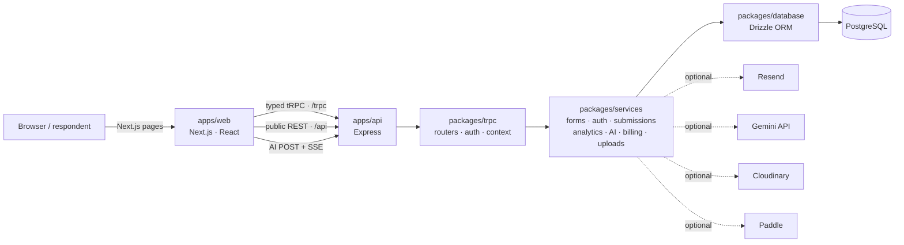

# Dockett

Dockett is a full-stack form platform for creating, publishing, and analyzing forms. Build a form from scratch, a template, or an AI-generated draft; share it with respondents; and review or export its responses.

Video Demo: [Click here](https://www.linkedin.com/feed/update/urn:li:activity:7520567003590623232/)

## What you can do

- Design forms with 12 field types, configurable themes and layouts, drag-and-drop ordering, and conditional question flows.
- Start from nine visual templates, including Classic, Survey, Education, Corporate, and Landing.
- Publish public or access-code-protected forms, optionally require verified respondent email, and set automatic closing.
- Collect anonymous or email-verified submissions, with server-side validation against the exact published form version.
- Review views, response trends, device mix, individual submissions, and CSV exports.
- Generate or refine forms with a streaming Gemini-powered assistant.
- Add file-upload questions backed by optional Cloudinary storage.
- Manage Basic, Pro, and Business plan entitlements; Pro checkout and subscription management use optional Paddle Billing.

## Architecture

The pnpm/Turborepo workspace separates the Next.js product UI, Express API, shared tRPC contract, domain services, and PostgreSQL persistence.



### Stack

| Area                 | Technology                                                                           |
| -------------------- | ------------------------------------------------------------------------------------ |
| Workspace and builds | pnpm 9, Turborepo 2                                                                  |
| Web                  | Next.js 16, React 19, TypeScript 5.9                                                 |
| UI                   | Tailwind CSS 4, Radix UI, React Query, tRPC React, React Hook Form, Recharts         |
| API                  | Node.js 24 in production, Express 5, tRPC 11, Zod, generated OpenAPI and Scalar docs |
| Persistence          | PostgreSQL 15, Drizzle ORM and Drizzle Kit                                           |
| Integrations         | Google sign-in, Resend email, Gemini AI, Cloudinary uploads, Paddle Billing          |
| Operations           | Docker, Docker Compose, Caddy, GitHub Actions, AWS EC2                               |

### Workspace map

- `apps/web` — public site, authentication, dashboard, form builder and respondent experience.
- `apps/api` — Express server, REST/OpenAPI and tRPC endpoints, health checks, and background lifecycle jobs.
- `packages/trpc` — shared router, input/output schemas, authentication procedures, and API services wiring.
- `packages/services` — form, field, submission, respondent, analytics, authentication, AI, billing, and upload business logic.
- `packages/database` — Drizzle connection, schema, models, and migrations.
- `packages/logger` — structured application logging.
- `packages/eslint-config`, `packages/typescript-config` — shared tooling configuration.

## Run locally

Prerequisites: Node.js 24 (Node 18+ is declared in the root package manifest), pnpm 9, and Docker Compose.

1. Copy `.env.example` to `.env`.
2. Set `POSTGRES_PASSWORD` and configure `DATABASE_URL` for the local Compose database, for example:

   ```text
   postgresql://postgres:<your-password>@localhost:5432/dev
   ```

3. Configure the required API values in `.env`: `JWT_SECRET` (at least 32 characters), `GOOGLE_CLIENT_ID`, `RESEND_API_KEY`, and `EMAIL_FROM_ADDRESS` (use a sender address verified with Resend). Configure the sender domain and Google OAuth application for your local URLs. Integration credentials for AI, billing, and uploads are optional and only enable those features.
4. Start PostgreSQL, apply migrations, then start the web app and API:

   ```sh
   pnpm install
   pnpm db:up
   pnpm db:migrate
   pnpm dev
   ```

   Open [http://localhost:3000](http://localhost:3000). The API listens on port `8000`; its health endpoint is [http://localhost:8000/health](http://localhost:8000/health).

5. Stop the local database when finished:

   ```sh
   pnpm db:down
   ```

The development database uses a dedicated Compose file and volume (`dockett_local_pg_data`), separate from the production database. Do not copy production credentials into a local environment.

## Useful commands

| Command                                            | Purpose                                                   |
| -------------------------------------------------- | --------------------------------------------------------- |
| `pnpm dev`                                         | Run the web app and API in development                    |
| `pnpm build`                                       | Build workspace applications and packages                 |
| `pnpm lint`                                        | Lint workspace packages                                   |
| `pnpm check-types`                                 | Run workspace type checks                                 |
| `pnpm db:up` / `pnpm db:down`                      | Start / stop the isolated local PostgreSQL service        |
| `pnpm db:generate`                                 | Generate Drizzle migrations from schema changes           |
| `pnpm db:migrate`                                  | Apply pending migrations                                  |
| `pnpm --filter @repo/api test:ai`                  | Run the API package's AI and billing unit-test script     |
| `pnpm --filter @repo/api test:ai:integration`      | Run the PostgreSQL-backed AI usage-store integration test |
| `pnpm --filter @repo/api test:billing:integration` | Run billing integration tests                             |

## API and deployment

- tRPC is served at `/trpc`; REST endpoints are generated at `/api`. OpenAPI JSON is at `/openapi.json` and interactive API docs at `/docs`.
- In production, Caddy terminates HTTPS and routes API paths to the API process and all other requests to Next.js.
- GitHub Actions runs lint and type checks on pushes to `main`, builds a combined Docker image, pushes commit-tagged and `latest` images to Docker Hub, then deploys to AWS EC2.
- Production runs the web and API processes in one application container alongside Caddy and PostgreSQL. Health checks gate service startup; the deploy script can roll the application image back if health checks fail.

For detailed architecture, domain behavior, engineering decisions, operational notes, and known constraints, see [Dockett.md](./Dockett.md).
